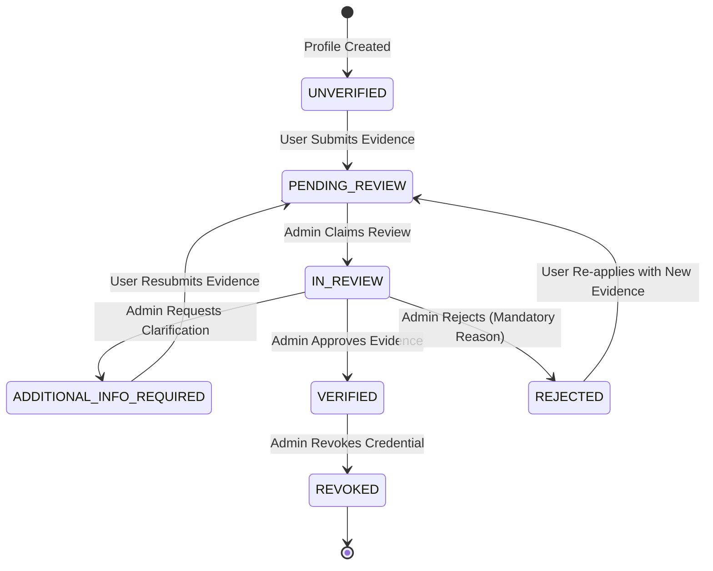

# Professional Verification Architecture

## Overview

This skill guides the architectural design of the professional credential verification system for **NeuroLink** (`PBL4_Web`). It establishes how accounts transition from self-declared claims to verified professional statuses, ensuring strict role separation between healthcare clinicians and academic neuroscience researchers while maintaining total isolation from external EEG systems.

## Purpose & Activation Criteria

Activate this skill when:
- Designing or extending data models, Prisma schemas, or migration plans for professional credential verification.
- Defining lifecycle states, transitions, and business rules for verification submissions.
- Structuring backend services, endpoints, and role-based access control (RBAC) in `server/src/modules/`.
- Architecting frontend submission flows and reviewer dashboards in `client/src/`.
- Reviewing system boundary adherence (ensuring no medical diagnosis or EEG processing pipelines are introduced).

---

## 1. System Ecosystem & Architectural Boundaries

NeuroLink is built as a modular monolith:
- **Backend**: Node.js LTS, Express v5, TypeScript, Prisma ORM v6, PostgreSQL 16, Zod schema validation.
- **Frontend**: React 19, Vite, TypeScript, Tailwind CSS v4, React Router v7, TanStack Query v5.
- **Authentication**: Stateful sessions stored as SHA-256 hashes in PostgreSQL, HttpOnly `SameSite=Lax` cookies, and session-bound CSRF token headers.

### Hard Boundary Constraints
1. **Independent System Boundary**: NeuroLink is strictly a professional social and academic networking platform. It is **NOT** an EEG database, signal processing engine, or clinical diagnostic system. Do not create EEG data ingestion, signal-processing pipelines, or AI diagnostic features.
2. **Human-in-the-Loop Imperative**: Automated systems (OCR, text matching) may assist reviewers by extracting text or flagging discrepancies, but **MUST NEVER** automatically grant `VERIFIED` status. Final verification authority resides exclusively with authorized human administrators.

---

## 2. Professional Profile Taxonomy

NeuroLink supports multi-capability professional accounts via `ProfessionalProfile`. Verification requirements diverge strictly based on `ProfessionalType`:

```
┌────────────────────────────────────────────────────────────────────────┐
│                         User Account (Role: USER)                      │
└──────────────────────────────────┬─────────────────────────────────────┘
                                   │ 1..2
         ┌─────────────────────────┴──────────────────────────┐
         ▼                                                    ▼
┌──────────────────────────────────┐ ┌──────────────────────────────────┐
│     HEALTHCARE_PROFESSIONAL      │ │            RESEARCHER            │
├──────────────────────────────────┤ ├──────────────────────────────────┤
│ Focus: Clinical care & medicine  │ │ Focus: Neuroscience & neurotech  │
│ Evidence: Medical practice       │ │ Evidence: Institutional affiliation│
│ licenses (CCHN), hospital        │ │ (.edu/.ac email or contract),    │
│ staff cards, specialist diplomas │ │ ORCID iD, published papers,      │
│ Target: Neurologists, doctors,   │ │ research lab credentials         │
│ clinical neurophysiologists      │ │ Target: BCI researchers, PhDs,   │
│                                  │ │ biomedical engineers, faculty    │
└──────────────────────────────────┘ └──────────────────────────────────┘
```

### Healthcare Professionals (`HEALTHCARE_PROFESSIONAL`)
- **Required Primary Evidence**: Government-issued Medical Practice License (Chứng chỉ hành nghề khám bệnh, chữa bệnh - CCHN) issued by the Ministry of Health (Bộ Y Tế) or Provincial Department of Health (Sở Y Tế).
- **Secondary Evidence**: Hospital/Clinic employment card or appointment letter, specialist medical degree (BS. CKI, CKII, ThS, TS Y học).
- **Verification Rule**: Must possess a verifiable clinical license number and verifiable issuing authority.

### Neuroscience Researchers (`RESEARCHER`)
- **Required Primary Evidence**: Academic/Institutional affiliation verification (official university/research institute email, staff ID card, or appointment decision).
- **Secondary Evidence**: Verifiable ORCID iD record, Scopus Author ID, Google Scholar profile, or verifiable scientific publications (DOI links in PubMed/IEEE/Nature/Science).
- **Verification Rule**: Must demonstrate active neuroscience, biomedical engineering, or cognitive science research affiliation.

---

## 3. Verification State Machine

Verification requests must adhere to a deterministic, finite state machine:



### Transition Authority Table

| From State | To State | Triggered By | Conditions & Invariants |
|---|---|---|---|
| `UNVERIFIED` | `PENDING_REVIEW` | Applicant (User) | At least 1 valid credential document uploaded; all required fields filled. |
| `PENDING_REVIEW` | `IN_REVIEW` | Reviewer (Admin) | Admin claims the request. Anti-self-approval check: `applicantId !== reviewerId`. |
| `IN_REVIEW` | `ADDITIONAL_INFO_REQUIRED` | Reviewer (Admin) | Specific clarification note required explaining what is missing. |
| `ADDITIONAL_INFO_REQUIRED` | `PENDING_REVIEW` | Applicant (User) | Applicant uploads requested supplemental documents. |
| `IN_REVIEW` | `VERIFIED` | Reviewer (Admin) | Legitimate credential confirmed. Sets `verifiedAt`, `verifiedById`. Profile badge reflects verification. |
| `IN_REVIEW` | `REJECTED` | Reviewer (Admin) | Mandatory rejection reason provided. Evidence marked rejected. |
| `VERIFIED` | `REVOKED` | Reviewer (Admin) | Mandatory revocation reason (e.g. license expiration, disciplinary action). |

---

## 4. Data Model Specifications (Prisma Schema Pattern)

To support this architecture when ready for implementation, model relations should follow this pattern:

```prisma
// Conceptual Model Specification - Do not apply directly without approval

enum VerificationRequestStatus {
  PENDING_REVIEW
  IN_REVIEW
  ADDITIONAL_INFO_REQUIRED
  VERIFIED
  REJECTED
  REVOKED
}

enum CredentialDocumentType {
  MEDICAL_LICENSE       // CCHN y tế
  HOSPITAL_STAFF_CARD   // Thẻ nhân viên y tế / bệnh viện
  ACADEMIC_DEGREE       // Bằng cấp y khoa / tiến sĩ / thạc sĩ
  INSTITUTION_AFFILIATION // Quyết định công tác / thẻ nghiên cứu viên
  ORCID_RECORD          // Bằng chứng hồ sơ ORCID / bài báo khoa học
  OTHER
}

model VerificationRequest {
  id                   String                    @id @default(uuid()) @db.Uuid
  profileId            String                    @db.Uuid
  profile              ProfessionalProfile       @relation(fields: [profileId], references: [id], onDelete: Cascade)
  userId               String                    @db.Uuid
  user                 User                      @relation(fields: [userId], references: [id], onDelete: Cascade)
  status               VerificationRequestStatus @default(PENDING_REVIEW)
  claimedTitle         String                    @db.VarChar(120)
  claimedSpecialty     String                    @db.VarChar(120)
  claimedInstitution   String?                   @db.VarChar(160)
  licenseOrOrcidNumber String?                   @db.VarChar(100)
  submissionNotes      String?                   @db.VarChar(1000)
  reviewNotes          String?                   @db.VarChar(1000)
  reviewerId           String?                   @db.Uuid
  reviewer             User?                     @relation("ReviewerAdmin", fields: [reviewerId], references: [id], onDelete: SetNull)
  reviewedAt           DateTime?
  createdAt            DateTime                  @default(now())
  updatedAt            DateTime                  @updatedAt

  documents            VerificationDocument[]
  auditLogs            VerificationAuditLog[]

  @@index([status, createdAt])
  @@index([userId])
}

model VerificationDocument {
  id           String                 @id @default(uuid()) @db.Uuid
  requestId    String                 @db.Uuid
  request      VerificationRequest    @relation(fields: [requestId], references: [id], onDelete: Cascade)
  documentType CredentialDocumentType
  storagePath  String                 @db.VarChar(500) // Private storage, NOT public uploads
  fileName     String                 @db.VarChar(255)
  mimeType     String                 @db.VarChar(100)
  sizeBytes    Int
  sha256Hash   String                 @db.Char(64)     // Tamper-evident checksum
  ocrData      Json?                                   // Extracted text & metadata
  uploadedAt   DateTime               @default(now())

  @@index([requestId])
}

model VerificationAuditLog {
  id           String                    @id @default(uuid()) @db.Uuid
  requestId    String                    @db.Uuid
  request      VerificationRequest       @relation(fields: [requestId], references: [id], onDelete: Cascade)
  actorId      String                    @db.Uuid
  actor        User                      @relation(fields: [actorId], references: [id])
  previousState VerificationRequestStatus
  newState     VerificationRequestStatus
  reason       String?                   @db.VarChar(1000)
  ipAddress    String?                   @db.VarChar(64)
  userAgent    String?                   @db.VarChar(300)
  timestamp    DateTime                  @default(now())

  @@index([requestId, timestamp])
}
```

---

## 5. Step-by-Step Working Procedure

When designing or revising the credential verification architecture:

1. **Step 1: Validate Applicant Classification**
   - Confirm whether the requirement targets clinical credentials (`HEALTHCARE_PROFESSIONAL`) or scientific research credentials (`RESEARCHER`).
   - Define exact required document types for that category.

2. **Step 2: Enforce Invariant State Transitions**
   - Map requested operations to the verification state machine.
   - Enforce server-side transition checks in the service layer (`server/src/modules/moderation/` or dedicated `verification/` module).
   - Reject any transition not explicitly permitted by the transition table.

3. **Step 3: Guard Authorization Boundaries**
   - Validate that applicants can only mutate their own `DRAFT` or resubmit `ADDITIONAL_INFO_REQUIRED` requests.
   - Validate that reviewers hold verified `ADMIN` role.
   - Validate anti-self-approval rule: `if (request.userId === adminUser.id) throw forbidden('Cannot review own verification request')`.

4. **Step 4: Model Private Document Storage**
   - Verification documents contain Sensitive Personal Information (PII) and medical license numbers.
   - Never store verification evidence in `server/uploads/` (which serves static public files).
   - Direct storage to a secure, private disk location (e.g. `server/storage/private_verifications/`) accessible only through authenticated, stream-piped endpoints.

5. **Step 5: Define Event & Notification Dispatches**
   - Ensure every status transition dispatches an in-app notification to the applicant via `notificationsApi` (e.g., `VERIFICATION_APPROVED`, `VERIFICATION_REJECTED`, `VERIFICATION_INFO_REQUESTED`).

---

## 6. Security and Reliability Constraints

- **Strict Non-Escalation**: Verification status of a profile must never grant `ADMIN` role. System permissions (`Role.ADMIN`) and clinical badges (`VerificationStatus.VERIFIED`) are completely independent.
- **Transaction Atomicity**: Updating `ProfessionalProfile.verificationStatus`, logging to `VerificationAuditLog`, and updating `VerificationRequest.status` must execute inside a single Prisma interactive transaction (`prisma.$transaction`).
- **Idempotency**: Retrying an approval or rejection must not corrupt audit trails or trigger duplicate notifications.

---

## 7. Expected Outputs

Any architectural task following this skill must produce:
1. **Schema Specification**: Clean Prisma schema additions or modifications ready for migration review.
2. **State Transition Matrix**: Complete table mapping current state, target state, actor, and preconditions.
3. **Endpoint Contracts**: Request/Response schemas validated by Zod for applicant submissions and reviewer evaluations.
4. **Audit Specification**: Complete mapping of logged events and compliance invariants.

---

## 8. Completion Checklist

- [ ] Clear distinction between Healthcare Professional vs. Researcher evidence standards maintained.
- [ ] Finite state machine covers all states: `UNVERIFIED`, `PENDING_REVIEW`, `IN_REVIEW`, `ADDITIONAL_INFO_REQUIRED`, `VERIFIED`, `REJECTED`, `REVOKED`.
- [ ] Human reviewer requirement enforced; zero auto-approval paths.
- [ ] Anti-self-approval rule explicitly designed into transition logic.
- [ ] Private document storage separated from public `/uploads` directory.
- [ ] Immutable audit logging specified for all state changes.
- [ ] No EEG data ingestion, signal processing, or medical diagnostic components included.
