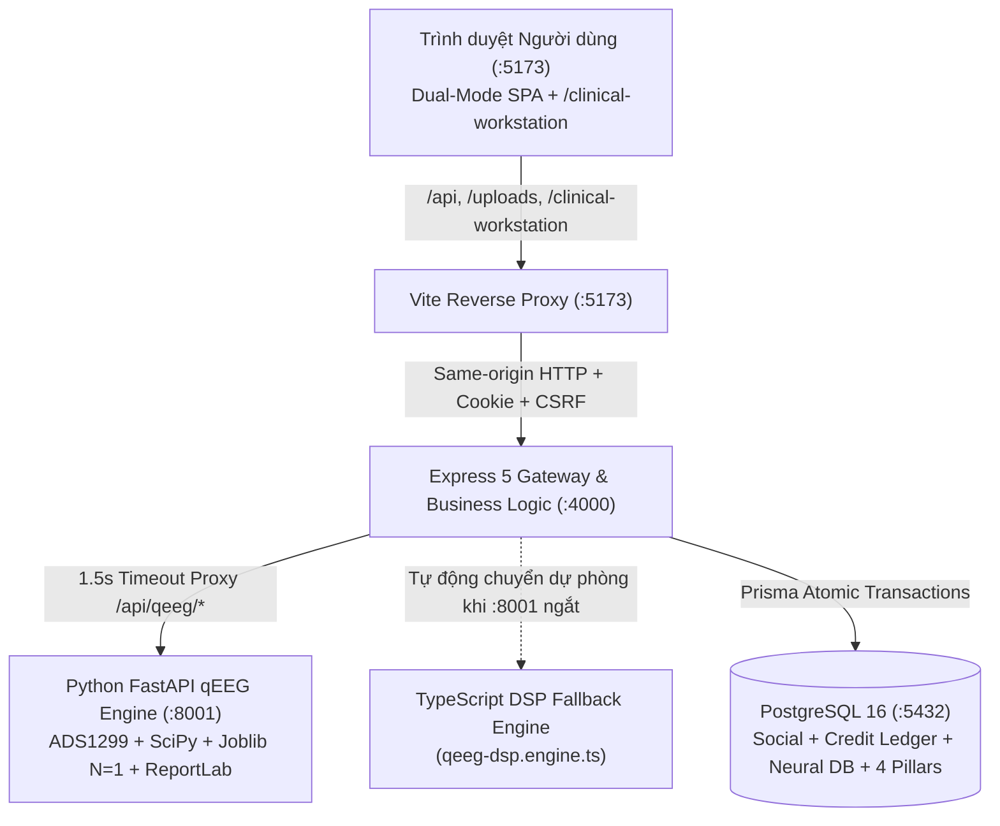

# Mental Model Hệ thống Hợp nhất NeuroLink (Social + qEEG + Neural DB + 4 Trụ cột)

Tài liệu này mô tả mô hình tư duy kiến trúc để bất kỳ kỹ sư hoặc nhà nghiên cứu nào khi tiếp quản mã nguồn đều hiểu rõ các đường biên tin cậy, bất biến dữ liệu và luồng tương tác giữa bốn lớp hệ thống.

---

## 1. Cấu trúc Bốn Lớp của Hệ thống Hợp nhất

Kiến trúc NeuroLink được tổ chức thành một khối liên thông gồm giao diện đơn trang Vite React (`client/` trên cổng `5173`), cổng API Express 5 + Prisma (`server/` trên cổng `4000`), dịch vụ xử lý tín hiệu Python FastAPI (`qeeg_service/` trên cổng `8001`) và cụm cơ sở dữ liệu PostgreSQL 16 (`5432`). Trình điều phối `start_unified_server.py` đóng vai trò nút khởi động duy nhất đảm bảo thứ tự phụ thuộc từ tầng dữ liệu lên tầng giao diện.

Mọi yêu cầu từ trình duyệt đi qua một nguồn gốc duy nhất (`http://127.0.0.1:5173`) nhờ cấu hình proxy của Vite sang cổng `4000`. Thiết kế này giữ cookie phiên `HttpOnly` và mã `CSRF` ở trạng thái first-party đồng nhất, đồng thời cho phép trang trạm lâm sàng tĩnh `qeeg_service/static/index.html` chạy mượt mà cả khi mở trực tiếp tại `:8001` lẫn khi nhúng qua route `/clinical-workstation` trên `:5173` hoặc `:4000`.

---

## 2. Cơ chế Dự phòng Kép và Bất biến Sinh lý qEEG

Để đảm bảo nền tảng web không bao giờ sập khi môi trường thiếu thư viện khoa học Python (`uvicorn`, `scipy`, `joblib`, `reportlab`), tầng Express đóng vai trò cổng phân luồng chủ động. Khi nhận yêu cầu phân tích tại `/api/qeeg/*`, Express ưu tiên chuyển tiếp sang dịch vụ FastAPI ở cổng `8001` với ngưỡng chờ tối đa 1,5 giây; nếu dịch vụ Python không phản hồi, động cơ TypeScript thuần (`qeeg-dsp.engine.ts`) lập tức tiếp quản tính toán sóng 6 kênh (F3, F4, C3, C4, O1, O2), nội suy bản đồ vỏ não 19 chuyển đạo và xuất vector 80 đặc trưng theo cùng hợp đồng `QeegAnalysisResult`.

Toàn bộ chỉ số trích xuất trên cả hai động cơ đều bám vào tính bất biến theo độ lợi khuếch đại phần cứng (gain invariance). Vì tỷ số công suất dải tần như DAR (Delta/Alpha Ratio) và TAR (Theta/Alpha Ratio) triệt tiêu hệ số khuếch đại $k^2$ về mặt đại số, hệ thống có thể đối chiếu bản ghi từ mạch TI ADS1299 24-bit ở hiện trường với chuẩn bệnh viện 10-20 mà không cần hiệu chuẩn lại từng bệnh nhân. Riêng nhóm bệnh lý mạch máu não cấp luôn đi qua tầng khóa an toàn `CM[2,1] = 0`: mọi dấu hiệu nghi ngờ xuất huyết não (ICH) đều khóa tuyệt đối trạng thái tiêu sợi huyết tPA và ép chỉ định chụp CT sọ não không cản quang trước mọi can thiệp.

---

## 3. Vòng đời Dữ liệu từ Tín hiệu Thô đến Neural Network DB

Một bản ghi điện não sau khi đi qua trạm phân tích chỉ trở thành tài sản huấn luyện mạng nơ-ron khi vượt qua rào chắn khử định danh và chuẩn hóa cấu trúc. Bốn nhóm lâm sàng (`VASCULAR_STROKE`, `EPILEPSY_ICU`, `SLEEP_COGNITIVE`, `HARDWARE_BCI`) phân tách rõ ràng ngữ cảnh thu thập tín hiệu, trong khi năm nhãn thực chứng (`CONTROL` = 0, `ISCHEMIC_STROKE` = 1, `HEMORRHAGIC_STROKE` = 2, `EPILEPTIFORM_SLOWING` = 3, `COGNITIVE_FATIGUE` = 4) cùng bốn tập phân mảnh (`TRAIN`, `VALIDATION`, `TEST`, `EXTERNAL_HOLDOUT`) tạo đầu vào trực tiếp cho bài toán phân loại đa lớp.

Khi người dùng bấm lưu mẫu từ trạm qEEG vào nền tảng (`POST /api/qeeg/save-to-platform`), hệ thống ghi đồng thời hai thực thể: một hồ sơ `EegDatasetRecord` thuộc quyền kiểm soát ủy quyền bác sĩ của chủ sở hữu (`grantConsent` / `revokeConsent`), và một bản ghi `NeuralTrainingSample` chứa vector 80 đặc trưng, các chỉ số DAR/BSI/TAR/PRI/wPLI và cờ xác nhận đã xóa thông tin định danh (`deidentifiedConfirmed = true`). Chỉ chuyên gia đã xác minh tích xanh mới có quyền nâng trạng thái xác nhận nhãn (`verifiedById`) thông qua giao thức `PATCH /api/neural-db/samples/:id/verify` trước khi cộng đồng nghiên cứu xuất toàn bộ tập mẫu thành CSV hoặc JSONL.

---

## 4. Các Đường biên Tin cậy và Bất biến Sổ cái Kinh tế

Đường biên tin cậy giữa người dùng phổ thông (`GENERAL_MODE`) và chuyên gia y khoa/nghiên cứu (`PROFESSIONAL_MODE`) luôn được phân giải tại backend (`experience.resolver.ts`), tuyệt đối không tin tưởng header giả lập từ trình duyệt. Quyền nhận ca tư vấn từ xa, niêm yết dữ liệu có thu phí trên Data Bank, thẩm định bài đóng góp chuyên môn và xác nhận nhãn Neural DB đều bị khóa bởi tầng kiểm tra quyền `assertVerifiedProfessional` dựa trên trạng thái `VERIFIED` trong PostgreSQL.

Trên tầng kinh tế nội bộ, sổ cái `CreditTransaction` áp dụng nguyên tắc chỉ ghi thêm (append-only) bọc trong giao dịch nguyên tử của Prisma. Số dư `CreditWallet.balance` không bao giờ bị sửa trực tiếp ngoài transaction và luôn tuân theo các bất biến bảo vệ dòng tiền:

| Luồng Giao dịch | Loại Giao dịch Sổ cái | Bất biến Bảo toàn |
|---|---|---|
| Cấp tín chỉ khởi đầu | `STARTER_GRANT` | Tối đa 1 lần duy nhất (`+250` tín chỉ) cho mỗi `userId` thông qua khóa chống trùng idempotency; tách biệt khỏi bước đăng ký tài khoản. |
| Hỏi đáp bác sĩ ngoài giờ | `CONSULTATION_ESCROW` → `CONSULTATION_EARNING` | Ký quỹ ngay khi tạo `ConsultationTicket`; chỉ giải ngân cho bác sĩ khi người hỏi bấm nghiệm thu; chặn tuyệt đối việc bác sĩ tự nhận và tự nghiệm thu ticket của chính mình. |
| Mua bán dữ liệu Data Bank | `DATABANK_PURCHASE` + `DATABANK_ROYALTY` | Cột `payloadCsvJson` bị ẩn hoàn toàn ở API công khai nếu `priceCredits > 0` và người gọi chưa mua; giao dịch mua đồng thời trừ tiền người mua, cộng bản quyền tác giả và tăng bộ đếm tải trong một Prisma transaction. |
| Chống rút tiền mặt trực tiếp | `RewardRedemption` (`payoutEnabled = false`) | Khoản đổi thưởng mặc định chỉ áp dụng cho CME, vé hội thảo, tài liệu và honoraria do quản trị viên phê duyệt; tự động hoàn tín chỉ qua `REFUND` nếu bị từ chối. |

---

## 5. Khối Tự phục vụ và Tác động Cộng đồng

Hai trụ cột còn lại đóng vai trò giữ nhịp sinh hoạt hàng ngày và tạo động lực danh tiếng. Phân hệ tự phục vụ (`HealthCheckIn` và `WorkingPlanBlock`) ràng buộc quyền truy cập chặt chẽ theo `userId` chủ sở hữu để người dùng theo dõi xu hướng mệt mỏi nhận thức (TAR), bất đối xứng bán cầu (BSI) và sắp xếp các khung giờ làm việc sâu hoặc phục hồi thần kinh. Ở lớp cộng đồng, bảng xếp hạng `community-insights/spotlight` tính toán điểm tác động từ số liệu thực trong PostgreSQL (bài viết công khai, lượt thích, người theo dõi, ca tư vấn hoàn thành và lượt tải Data Bank), đảm bảo độ nổi bật của bác sĩ và nhà nghiên cứu phản ánh đúng đóng góp chuyên môn thay vì thủ thuật tương tác ảo.
