# Chiến lược Khởi nghiệp, Mô hình Kinh doanh & Quản trị Rủi ro Lâm sàng — NeuroLink

Tài liệu này hệ thống hóa kiến trúc thương mại và chiến lược phòng thủ của nền tảng NeuroLink khi hợp nhất mạng xã hội chuyên môn y khoa, trạm điện não đồ định lượng (qEEG) 6 kênh ADS1299, cơ sở dữ liệu huấn luyện mạng nơ-ron và bốn trụ cột vận hành sản phẩm. Toàn bộ phân tích sử dụng khung **Business Model Canvas (BMC)** của Alexander Osterwalder, **7 Powers** của Hamilton Helmer, **Strategyzer Testing Business Ideas** và các ràng buộc an toàn sinh lý học được kiểm chứng trực tiếp trên mã nguồn.

---

## 1. Luận điểm Cốt lõi & Nỗi đau Hai Phía của Thị trường Điện não Đồ

Thị trường theo dõi và chẩn đoán điện não đang bị chia cắt thành hai thái cực không giao tiếp với nhau. Tại các bệnh viện tuyến cuối, hệ thống EEG 19–32 kênh đạt chuẩn lâm sàng nhưng cồng kềnh, tốn nhân lực gắn điện cực và hầu như không hiện diện trên xe cấp cứu 115 hay phòng khám tuyến cơ sở. Ngược lại, các thiết bị đo điện não tiêu dùng 1–4 kênh ngoài thị trường dễ tiếp cận nhưng thiếu chuẩn hóa vị trí điện cực 10-20, không có bác sĩ chuyên khoa thẩm định và thiếu cơ chế sàng lọc nhiễu vận động dẫn đến kết quả vô giá trị về mặt lâm sàng.

Sự đứt gãy này tạo ra ba nút thắt đồng thời cho ba nhóm người dùng. Người bệnh sau xuất viện hoặc người làm việc trí óc cường độ cao không có công cụ tự theo dõi chỉ số suy giảm nhận thức hay bất đối xứng bán cầu theo thời gian thực. Bác sĩ tuyến dưới và điều dưỡng cấp cứu thiếu kênh hội chẩn nhanh bản ghi sóng não với chuyên gia thần kinh khi đứng trước ca nghi đột quỵ hoặc động kinh ngoài giờ hành chính. Trong khi đó, các nhóm nghiên cứu khoa học thần kinh và kỹ sư giao diện não - máy tính (BCI) tiêu tốn hàng tháng trời đi xin dữ liệu rời rạc vì thiếu một kho dữ liệu đa trung tâm đã khử định danh và có nhãn bác sĩ xác thực.

NeuroLink giải quyết đồng thời ba nút thắt trên bằng cách giữ chân người dùng và bác sĩ trên cùng một hạ tầng dữ liệu thống nhất. Phần cứng 6 kênh TI ADS1299 (F3, F4, C3, C4, O1, O2) tái tạo bản đồ não 19 chuyển đạo theo phép nội suy spherical spline, xuất ra vector đặc trưng 80 chiều và các chỉ số bất biến độ lợi khuếch đại (DAR, TAR, BSI, PRI, wPLI), rồi đưa thẳng kết quả đó vào vòng tuần hoàn hỏi đáp bác sĩ, lưu trữ ngân hàng dữ liệu và huấn luyện mô hình.

---

## 2. Bản đồ hóa 4 Trụ cột Quan hệ Khách hàng vào 9 Khối Business Model Canvas

Trong giai đoạn định hình sản phẩm, bốn trụ cột **Customer Relationships** được thiết kế không tách rời nhau thành bốn ứng dụng rời rạc, mà gắn chặt vào mô hình dữ liệu PostgreSQL (`schema.prisma`) và sổ cái tín chỉ (`CreditWallet` / `CreditTransaction`).

### 2.1. Diễn giải 4 Trụ cột Vận hành trên Thực tế Mã nguồn

**Trụ cột 1 — Personal Assistance (Mô hình Hỏi đáp Y khoa Ngoài giờ kiểu Qanda):** Tương tự cách Qanda tận dụng thời gian rảnh của sinh viên giỏi để giải bài tập trực tuyến cho học sinh với chi phí biên thấp, NeuroLink mở ra hàng đợi đọc bản ghi qEEG từ xa (`ConsultationTicket` và `ConsultationReply`) dành cho bác sĩ nội trú thần kinh, bác sĩ trẻ có chứng chỉ hành nghề và nhà khoa học thần kinh đã qua xác minh tích xanh (`bs_noitru_khang`, `dr_minh`). Người dùng phổ thông hoặc nhân viên y tế tuyến dưới đăng câu hỏi kèm mẫu sóng não đã khử định danh và ký quỹ tín chỉ (`CONSULTATION_ESCROW`). Khi mẫu có bất đối xứng bán cầu `bsi >= 0.22`, chỉ số sóng chậm `dar >= 3.2` hoặc từ khóa đột quỵ cấp, hệ thống tự động bật cờ `urgentRedFlag = true` để ép hiển thị khuyến cáo gọi cấp cứu 115 trước khi chờ phản hồi. Sau khi bác sĩ nội trú nhận ca, giải thích từng dải tần và người hỏi bấm nghiệm thu, tín chỉ mới giải ngân qua giao dịch `CONSULTATION_EARNING`.

**Trụ cột 2 — Co-creation & Data Bank (Chợ Dữ liệu & Đồng sáng tạo Nghiên cứu):** Dữ liệu đo từ thiết bị thực địa và ca lâm sàng sau khi khử định danh được đóng gói thành hai lớp: mẫu huấn luyện chuẩn hóa (`NeuralTrainingSample`) phục vụ xuất định dạng CSV/JSONL 80 đặc trưng, và gói dữ liệu chuyên sâu trên chợ trao đổi (`DataBankListing`). Tác giả giữ quyền kiểm soát mô tả phương pháp luận và bộ chỉ số xem trước (`previewMetricsJson`) để người mua đánh giá chất lượng trước khi thanh toán tín chỉ (`DATABANK_PURCHASE`). Giao dịch thành công kích hoạt hạch toán bản quyền tự động (`DATABANK_ROYALTY`) về ví tác giả và mở khóa đường dẫn tải CSV gốc.

**Trụ cột 3 — Self-Services (Tự theo dõi Điện não & Điều phối Lịch Làm việc):** Để người dùng phổ thông (`hoa_health`) không rời bỏ nền tảng ngay sau một lần hỏi bệnh, phân hệ tự phục vụ (`HealthCheckIn` và `WorkingPlanBlock`) chuyển hóa các chỉ số điện não thành thói quen điều tiết năng suất hàng ngày. Người dùng theo dõi điểm tập trung, chỉ số mệt mỏi nhận thức TAR, thời lượng ngủ và mức căng thẳng qua nhiều ngày, từ đó sắp xếp các khối công việc sâu (`DEEP_WORK`), công việc hành chính nhẹ (`LIGHT_ADMIN`) hay phục hồi thần kinh (`NEURO_RECOVERY`) có gắn lý giải sinh lý học đi kèm. Toàn bộ dữ liệu cá nhân được bảo vệ bằng cơ chế cấp và thu hồi quyền truy cập cho từng bác sĩ cụ thể (`grantConsent` / `revokeConsent`).

**Trụ cột 4 — Community (Chia sẻ Tri thức Mở & Xây dựng Uy tín Học thuật):** Mạng xã hội chuyên môn (`Post`, `Contribution`, `CommunityInsights`) đóng vai trò phễu thu hút tự nhiên cho cả hai phía thị trường. Bảng xếp hạng chuyên gia tiêu biểu (`/api/community-insights/spotlight`) tổng hợp chỉ số tác động thực tế từ bài viết công khai, lượt thích, người theo dõi, số ca tư vấn được nghiệm thu và lượt tải gói dữ liệu trên Data Bank. Cơ chế này tạo đòn bẩy danh tiếng nghề nghiệp: bác sĩ trẻ và nghiên cứu sinh đóng góp ca lâm sàng chất lượng để tích lũy uy tín cộng đồng, từ đó thu hút người dùng đặt câu hỏi đích danh hoặc mua bộ dữ liệu nghiên cứu của mình.

### 2.2. Khung 9 Khối Business Model Canvas (Alexander Osterwalder)

| Khối BMC | Cấu trúc Triển khai tại NeuroLink | Neo kỹ thuật trong Hệ thống |
|---|---|---|
| Customer Segments | Ba phân khúc phụ thuộc lẫn nhau: (1) Người dùng quan tâm sức khỏe não bộ và phòng khám tuyến cơ sở cần sàng lọc sớm; (2) Bác sĩ thần kinh, bác sĩ nội trú cần thu nhập ngoài giờ, điểm CME và ca bệnh thực tế; (3) Nhà nghiên cứu khoa học thần kinh, kỹ sư BCI cần tập dữ liệu qEEG đa trung tâm gắn nhãn chuẩn xác. | `ExperienceResolution` (`GENERAL_MODE` vs `PROFESSIONAL_MODE`), `ProfessionalProfile` (`HEALTHCARE_PROFESSIONAL`, `RESEARCHER`). |
| Value Propositions | Với người bệnh/tuyến dưới: phản hồi sàng lọc sóng não nhanh ngoài giờ với rào chắn cảnh báo cấp cứu 115. Với bác sĩ nội trú: chuyển hóa thời gian trống thành tín chỉ CME, tài liệu và thu nhập cộng tác minh bạch. Với nhà nghiên cứu: rút ngắn chu kỳ thu thập dữ liệu bằng bộ 80 đặc trưng chuẩn hóa và kiểm định ngoại kiểm. | `qeeg_service` (6-to-19 spherical spline, 4 nhóm bệnh lý), `NeuralTrainingSample` (CSV/JSONL 80-dim). |
| Channels | Kênh web hợp nhất một điểm chạm (`/feed`, `/eeg-hub`, `/consultations`, `/clinical-workstation`), cổng phần cứng TI ADS1299 qua file CSV 500 Hz, và lan truyền học thuật qua hồ sơ tác giả công khai (`/u/:username`). | Vite SPA proxy (`/api`, `/clinical-workstation`), `ads1299_500hz_sample.csv`. |
| Customer Relationships | Bốn trụ cột liên kết chặt chẽ: Personal Assistance (hỏi đáp ngoài giờ Qanda), Co-creation & Data Bank (đồng sáng tạo dữ liệu), Self-Services (nhật ký tự theo dõi và kế hoạch làm việc), và Community (cộng đồng học thuật và bảng vinh danh chuyên gia). | `ConsultationTicket`, `DataBankListing`, `HealthCheckIn`, `WorkingPlanBlock`, `community-insights`. |
| Revenue Streams | (1) Phí nền tảng (take-rate) trên mỗi giao dịch tư vấn qEEG từ xa; (2) Phí môi giới và lưu trữ trên giao dịch mua bán gói dữ liệu Data Bank; (3) Gói thuê bao B2B/SaaS cho phòng khám vệ tinh sử dụng trạm đọc qEEG không giới hạn và xuất báo cáo PDF; (4) Tài trợ khóa học CME và tuyển dụng y khoa từ các hãng dược/thiết bị y tế. | `CreditTransaction` (`CONSULTATION_ESCROW`, `DATABANK_PURCHASE`), xuất báo cáo ReportLab PDF. |
| Key Resources | Tài sản trí tuệ lõi gồm pipeline phân tích N=1 bất biến độ lợi, trọng số mô hình đã ngoại kiểm trên tập UCLH London (`N=28`), kho mẫu `NeuralTrainingSample` do bác sĩ CCHN xác nhận, và mạng lưới chuyên gia đã thẩm định hồ sơ (`VerificationRequest` + OCR + SHA-256). | `stroke_3class_production_model.joblib`, `hospital_grade_n1_benchmark_results.json`, PostgreSQL 16. |
| Key Activities | Duy trì hạ tầng xử lý tín hiệu qEEG thời gian thực có cơ chế dự phòng kép (Python FastAPI + TypeScript DSP), vận hành quy trình xét duyệt tích xanh 6 bước chống giả mạo bác sĩ, kiểm duyệt 5 tiêu chí đối với đóng góp học thuật và bảo toàn sổ cái tín chỉ nguyên tử. | `qeeg.routes.ts`, `qeeg-dsp.engine.ts`, `verification.routes.ts`, `contributions.service.ts`. |
| Key Partnerships | Bộ môn Kỹ thuật Y sinh và các nhóm chế tạo mạch ADS1299, các bệnh viện tuyến tỉnh/phòng khám đa khoa cần đọc điện não từ xa, Hội đồng thẩm định CME và các trung tâm nghiên cứu BCI đại học. | Cộng đồng chuyên khoa trong `communities`, tài khoản đối tác nghiên cứu. |
| Cost Structure | Chi phí hạ tầng máy chủ tính toán tín hiệu và lưu trữ chuỗi thời gian EEG, chi phí xác minh thủ công chứng chỉ hành nghề và kiểm duyệt nội dung y khoa, chi phí tài trợ tín chỉ khởi đầu (`STARTER_GRANT`) và quỹ quy đổi quyền lợi CME/hội thảo. | `CreditWallet`, `RewardCatalog`, kiểm toán `AdminRewards`. |

Xét theo nguyên tắc **Structural Coherence** của Osterwalder, vế phải (Value Propositions, Customer Relationships, Segments, Revenue) và vế trái (Activities, Resources, Partners, Cost) đạt độ cân xứng hai chiều vì mỗi dòng doanh thu đều đi kèm hoạt động tạo giá trị cụ thể và chi phí kiểm soát rủi ro y khoa tương ứng. Điểm cần cảnh báo về cấu trúc là chi phí cố định cho khâu thẩm định chứng chỉ hành nghề (Verification) và kiểm duyệt an toàn y khoa không giảm tuyến tính khi mở rộng sang các tỉnh mới nếu thiếu tự động hóa OCR và mạng lưới reviewer địa phương.

---

## 3. Vòng quay Tăng trưởng Hai Phía (Dual-Sided Clinical-Research Flywheel)

Mô hình mạng xã hội y khoa đơn thuần thường chết vì thiếu tần suất sử dụng: bác sĩ không có lý do đăng nhập mỗi ngày nếu chỉ để đọc tin tức. Ngược lại, phần mềm phân tích EEG thuần túy lại thiếu lưu lượng người dùng đầu vào. Thiết kế hợp nhất của NeuroLink tạo ra một vòng quay hai chiều tự gia cố theo chu trình khép kín dưới đây.

```mermaid
flowchart LR
    U["Người dùng & Tuyến dưới<br/>(Self-Service + Triage)"] -->|"Tải CSV / Đặt câu hỏi ký quỹ"| Q["Trạm qEEG & Hàng đợi Từ xa<br/>(4 nhóm bệnh lý + Cờ 115)"]
    Q -->|"Tạo thu nhập & ca bệnh ngoài giờ"| D["Bác sĩ Nội trú & Chuyên gia<br/>(Personal Assistance)"]
    D -->|"Gán nhãn lâm sàng & Thẩm định"| N["Neural DB & Data Bank<br/>(Vector 80 chiều + Co-creation)"]
    N -->|"Xuất CSV/JSONL & Tài trợ nghiên cứu"| R["Nhà khoa học Thần kinh & BCI<br/>(Cải tiến mô hình N=1)"]
    R -->|"Công bố kết quả & Bảng tin mở"| C["Cộng đồng & Spotlight<br/>(Tăng uy tín & Giảm CAC)"]
    C -->|"Thu hút niềm tin người bệnh mới"| U
```

Điểm kích hoạt (ignition point) của vòng quay nằm ở sự chênh lệch chi phí cơ hội của bác sĩ nội trú và bác sĩ trẻ trong khung giờ tối hoặc cuối tuần. Thay vì mất nhiều năm xây kênh cá nhân trên mạng xã hội đại chúng vốn đầy nhiễu loạn tin giả, họ nhận ngay các ca có sẵn bản đồ não 19 chuyển đạo, chỉ số DAR/BSI/TAR định lượng sẵn và phần thưởng tín chỉ/honoraria rõ ràng. Mỗi ca tư vấn được nghiệm thu không chỉ tạo giá trị tức thời cho người hỏi mà còn sản sinh thêm một bản ghi có nhãn chuyên gia trong `NeuralTrainingSample`, trực tiếp làm giàu cho nhánh nghiên cứu ở nửa còn lại của vòng quay.

---

## 4. Đánh giá Phòng thủ Chiến lược theo Hamilton Helmer's 7 Powers

Áp dụng khung chấm điểm **7 Powers** (thang 1–5 cho từng sức mạnh, tổng 35 điểm), NeuroLink ở giai đoạn khởi đầu không sở hữu đầy đủ cả bảy lợi thế, nhưng hội tụ hai lợi thế lõi đủ sâu để ngăn đối thủ sao chép bề nổi giao diện.

| Trụ cột 7 Powers | Điểm ước lượng | Đánh giá Thực chất & Cơ chế Bảo vệ |
|---|---|---|
| Cornered Resource (Tài nguyên độc quyền) | 4 / 5 | Đây là hào lũy quan trọng nhất của NeuroLink. Bất kỳ nhóm kỹ sư nào cũng có thể tải bộ trọng số học máy mã nguồn mở hoặc dựng một diễn đàn React, nhưng không dễ sở hữu kho `NeuralTrainingSample` kết hợp chuẩn phần cứng 6 kênh TI ADS1299 với nhãn xác thực bởi bác sĩ có chứng chỉ hành nghề (`verifiedById`) và dữ liệu ngoại kiểm mù UCLH London (`N=28`). Càng nhiều ca tư vấn ngoài giờ đi qua hệ thống, tài nguyên dữ liệu độc quyền này càng nới rộng khoảng cách với các đối thủ chỉ làm phần mềm thuần túy. |
| Network Economies (Kinh tế mạng lưới) | 4 / 5 | Tồn tại đồng thời hiệu ứng mạng lưới chéo (cross-side) và cùng phía (same-side). Khi số lượng bác sĩ nội trú trực hàng đợi tăng, thời gian chờ phản hồi giảm xuống dưới ngưỡng sốt ruột của người dùng, kéo theo lượng ticket ký quỹ tăng. Ở nhánh Data Bank, số lượng nhà nghiên cứu càng đông thì càng nhiều gói dữ liệu 4 nhóm bệnh lý (`VASCULAR_STROKE`, `EPILEPSY_ICU`, `SLEEP_COGNITIVE`, `HARDWARE_BCI`) được chia sẻ và kiểm chứng chéo, biến nền tảng thành điểm đến mặc định khi cần tìm dữ liệu EEG tiếng Việt và dữ liệu ADS1299. |
| Counter-Positioning (Định vị phản trực giác) | 3 / 5 | Các hãng thiết bị điện não bệnh viện truyền thống bán phần cứng giá cao kèm phần mềm đóng theo máy; họ không dám mở mô hình đọc từ xa giá rẻ trên phần cứng 6 kênh di động hay cho phép bác sĩ ngoài bệnh viện nhận thù lao đọc ca vì sẽ tự ăn mòn doanh thu bán thiết bị và hợp đồng bảo trì tại bệnh viện lớn. |
| Switching Costs (Chi phí chuyển đổi) | 3 / 5 | Với người dùng cá nhân, chi phí chuyển đổi tăng dần theo chuỗi ngày lưu trữ `HealthCheckIn`, `WorkingPlanBlock` và lịch sử sóng não qua nhiều tháng. Với bác sĩ và nhà nghiên cứu, hồ sơ uy tín tích lũy (`impactScore`), danh mục công bố khoa học, quyền lợi CME và mạng lưới bệnh nhân ủy quyền dữ liệu tạo rào cản rời bỏ đáng kể. |
| Process Power (Năng lực quy trình) | 3 / 5 | Sự kết hợp giữa quy trình trích xuất đặc trưng bất biến độ lợi khuếch đại (`DAR/TAR/BSI`), cổng kiểm định an toàn tPA đa tầng và cơ chế thẩm định hồ sơ CCHN/ORCID tạo ra độ phức tạp tổ chức mà một bản sao giao diện không thể vận hành trơn tru ngay lập tức. |
| Brand (Sức mạnh thương hiệu) | 2 / 5 | Ở giai đoạn hiện tại, thương hiệu NeuroLink mới hình thành trong ngách chuyên môn. Việc tránh xa ngôn từ thổi phồng "AI thần thánh", giữ giao diện y khoa chừng mực và trích dẫn minh bạch giới hạn ngoại kiểm là cách duy nhất để xây niềm tin với bác sĩ lâm sàng, nhưng cần 18–24 tháng vận hành sạch sự cố mới thành hào lũy thương hiệu thực sự. |
| Scale Economies (Lợi thế quy mô) | 2 / 5 | Chi phí hạ tầng lưu trữ và tính toán FastAPI/Node giảm nhẹ trên mỗi đơn vị người dùng khi mở rộng, song khâu thẩm định chứng chỉ hành nghề và hòa giải tranh chấp y khoa vẫn có phần chi phí biến đổi phụ thuộc con người. |

Tổng điểm đánh giá đạt **21 / 35** (Strong Emerging Moat — Tier 2). Động lực tăng trưởng dài hạn phụ thuộc trực tiếp vào việc biến **Cornered Resource** (dữ liệu gán nhãn bởi bác sĩ) và **Network Economies** (thanh khoản hàng đợi đọc ca từ xa) thành động cơ kéo trước khi đối thủ có vốn lớn sao chép giao diện.

---

## 5. Đòn bẩy Kinh tế Đơn vị (Unit Economics Levers) & Bài toán Thanh khoản

Theo khung tính toán của `FinancialSimulator` trong `business_model_architect`, sức khỏe tài chính của nền tảng hai phía không nằm ở lượt đăng ký ảo mà nằm ở bốn đòn bẩy kinh tế đơn vị cho từng phân khúc.

Đòn bẩy thứ nhất là **CAC Hữu cơ qua Cộng đồng và Chuyên gia (Community-Led Acquisition)**. Khi bác sĩ nội trú và giảng viên chia sẻ bài phân tích ca lâm sàng hay trên bảng tin công khai, các bài viết đó được chia sẻ ra ngoài mạng lưới đồng nghiệp và sinh viên y khoa, giúp hệ số lan truyền truyền miệng (tham số $q$ trong mô hình khuếch tán Bass) cao hơn chi phí mua quảng cáo trực tiếp ($p$). Nhờ vậy, chi phí thu hút một người dùng mới (`CAC`) được kéo xuống thấp thay vì đốt ngân sách quảng cáo y tế vốn rất đắt đỏ và bị siết chặt bởi chính sách nền tảng. Tuy nhiên, chiến lược cấp `STARTER_GRANT` (+250 tín chỉ khởi đầu cho mỗi tài khoản mới) là một khoản nợ tiếp thị phải được kiểm soát chặt: nếu người dùng chỉ nhận 250 tín chỉ để hỏi miễn phí một lần rồi rời đi mà không nạp thêm hoặc không đóng góp bài viết/dữ liệu, nền tảng sẽ rơi vào trạng thái đốt quỹ tài trợ chuyên gia mà không tạo vòng lặp doanh thu.

Đòn bẩy thứ hai là **Tỷ lệ Take-Rate và Chu kỳ Vốn trên Hàng đợi Tư vấn (Q&A Liquidity)**. Trên mỗi `ConsultationTicket`, phần chênh lệch giữa khoản ký quỹ của người hỏi và khoản giải ngân cho bác sĩ (mức take-rate mục tiêu 15%–20%) phải đủ bù đắp chi phí máy chủ phân tích qEEG và quỹ bảo chứng tranh chấp. Chỉ số sống còn cần theo dõi hàng tuần không phải tổng số câu hỏi, mà là **Thời gian nhận ca trung vị (Median Time-to-Claim)** và **Tỷ lệ nghiệm thu (`Accepted / Total`)**. Nếu một câu hỏi treo quá 12 giờ không có bác sĩ nhận, người hỏi sẽ không bao giờ quay lại; ngược lại, nếu bác sĩ trả lời hời hợt dẫn đến người hỏi không bấm nghiệm thu, bác sĩ sẽ rút khỏi hàng đợi.

Đòn bẩy thứ ba là **Biên Lợi nhuận Gộp và Doanh thu Tái sử dụng của Data Bank**. Khác với dịch vụ tư vấn tốn thời gian thực của bác sĩ theo tỷ lệ 1:1, một gói dữ liệu trên `DataBankListing` được đóng gói một lần nhưng có thể bán lặp lại cho nhiều nhóm nghiên cứu hoặc doanh nghiệp phát triển thuật toán. Với cấu trúc chia sẻ bản quyền 80% cho tác giả (`DATABANK_ROYALTY`) và 20% phí vận hành nền tảng, chi phí biên cho lượt tải thứ hai trở đi gần như bằng không, đẩy biên lợi nhuận gộp của mảng này lên trên 75%.

Đòn bẩy thứ tư là **Chiến lược Neo Khởi tạo (Anchor Cohort Strategy) và Rào cản Tâm lý 9x**. Theo hiệu ứng 9x của John Gourville và hệ số ác cảm mất mát $\lambda = 2.25$ trong Lý thuyết Triển vọng của Kahneman-Tversky, cả bác sĩ lẫn phòng khám đều đánh giá quá cao sự phiền toái khi phải học một giao diện mới so với lợi ích trừu tượng. Để vượt qua ngưỡng quán tính này, NeuroLink không bán phần mềm đại trà ngay lập tức, mà sử dụng tập dữ liệu mẫu chuẩn 6 ca (`case_ischemia_lvo`, `case_ich_hemorrhage`, `case_epilepsy_temporal`, `case_sleep_fatigue_n3`, `case_healthy_alpha`, `case_ads1299_hardware`) và báo cáo PDF ReportLab một trang định dạng sẵn để giảm thời gian làm quen xuống dưới 5 phút ngay trên trình duyệt.

---

## 6. Mặt trái Thẳng thắn, Failure Modes & Biện pháp Giảm thiểu Rủi ro Lâm sàng - Pháp lý

Một chiến lược khởi nghiệp nghiêm túc trong lĩnh vực y tế phải bắt đầu từ những kịch bản sụp đổ thực tế nhất thay vì giả định mọi tác nhân đều hành xử lý tưởng. Dưới đây là năm rủi ro trọng yếu của mô hình NeuroLink và các cơ chế kỹ thuật đã hoặc bắt buộc phải dựng lên để khóa rủi ro.

### 6.1. Sai số Phân loại Đột quỵ & Ràng buộc Khóa An toàn tPA (`CM[2,1] = 0`)

**Bản chất rủi ro:** Trong cấp cứu đột quỵ cấp, việc dùng nhầm thuốc tiêu sợi huyết đường tĩnh mạch (r-tPA) cho bệnh nhân đang xuất huyết não (ICH) gây biến chứng tử vong hoặc tàn phế nặng nề. Các mô hình học máy thuần túy dễ mắc lỗi dương tính giả khi gặp các ca xuất huyết thể tích nhỏ (small ICH) hoặc nhiễu vận động trên thiết bị 6 kênh.

**Bằng chứng & Biện pháp khóa cứng trong mã nguồn:** Kết quả ngoại kiểm mù trên tập UCLH London (`N=28`: 10 khỏe mạnh, 10 thiếu máu cục bộ, 8 xuất huyết não) cho thấy mô hình `X2` đạt balanced accuracy 3 trạng thái `81.67%` và binary AUROC `0.8722`, với độ nhạy thiếu máu cục bộ `100%` (`10/10`) nhưng độ nhạy xuất huyết não đơn thuần mới đạt `62.5%` (`5/8`). Chính vì hiểu rõ giới hạn độ nhạy `62.5%` này (thay vì che giấu), tầng Stage 3 Safety Veto (`experiment_5_stroke_subtyping_and_tpa_lockout`) áp đặt quy tắc bất khả xâm phạm `CM[2,1] = 0`: cả 8/8 ca ICH trên tập UCLH (bao gồm cả các ca nhỏ như P5, P17, P20 vốn bị bộ phân loại ngây thơ cho qua) đều bị chặn cứng ở trạng thái `HOLD tPA / MANDATORY CT` (`uclh_ich_cleared_for_tpa = 0`). Trên giao diện trạm qEEG và báo cáo PDF, trạng thái nghi xuất huyết kích hoạt khóa đỏ/tím tuyệt đối, không bao giờ hiển thị khuyến nghị tiêm tPA nếu chưa đối chiếu phim chụp CT sọ não không cản quang tại bệnh viện.

### 6.2. Rủi ro Pháp lý: Tư vấn Định hướng (Triage Advice) vs Y lệnh Bệnh viện (Hospital Orders)

**Bản chất rủi ro:** Theo Luật Khám bệnh, chữa bệnh, việc chẩn đoán xác định và kê đơn điều trị từ xa đòi hỏi cơ sở pháp lý, hồ sơ bệnh án điện tử đạt chuẩn và phạm vi chuyên môn được cấp phép cụ thể. Nếu bác sĩ nội trú trên hàng đợi Qanda viết câu trả lời mang tính kê đơn thuốc hoặc khẳng định chẩn đoán thay thế bác sĩ điều trị trực tiếp, cả bác sĩ lẫn công ty vận hành nền tảng đều đối mặt trách nhiệm pháp lý nghiêm trọng khi xảy ra tai biến.

**Biện pháp phân tách cấu trúc:** Giao thức trả lời `ConsultationReply` không cho phép nhập một đoạn văn tự do dễ gây hiểu lầm, mà ép tách làm ba trường độc lập: `waveAnalysisText` (mô tả khách quan hình thái sóng, chỉ số DAR/BSI/TAR/wPLI), `clinicalGuidanceText` (giải thích kiến thức y khoa và định hướng nguy cơ tham khảo), và `recommendedFollowUp` (khuyến nghị thăm khám trực tiếp, chụp CT/MRI hoặc khám chuyên khoa thần kinh). Mọi ca có chỉ số nguy cơ cao tự động kích hoạt cờ `urgentRedFlag = true` kèm biểu ngữ hướng dẫn gọi 115 ngay lập tức thay vì chờ bác sĩ gõ phản hồi.

### 6.3. Lựa chọn Ngược (Adverse Selection) & Suy thoái Chất lượng Hai Phía

**Bản chất rủi ro:** Nếu thù lao cho một ca đọc sóng não quá thấp hoặc người hỏi được phép spam câu hỏi miễn phí vô hạn, bác sĩ có năng lực cao sẽ rời bỏ hàng đợi vì chi phí cơ hội không tương xứng, chỉ để lại những người thiếu kinh nghiệm hoặc dùng mẫu trả lời máy móc. Ngược lại, ở chợ Data Bank, người bán thiếu trung thực có thể đẩy các file CSV chứa nhiễu điện lưới 50 Hz hoặc sóng giả lập để thu tín chỉ bản quyền.

**Biện pháp kỹ thuật & kinh tế:** Thứ nhất, cổng chất lượng tín hiệu (`signalQualityScore`) phải được tính toán tự động trước khi cho phép lưu mẫu vào `NeuralTrainingSample` hoặc niêm yết lên `DataBankListing`. Thứ hai, cơ chế ký quỹ tín chỉ bắt buộc (`CONSULTATION_ESCROW`) và giới hạn khoản tặng khởi đầu `STARTER_GRANT` một lần duy nhất trên mỗi tài khoản ngăn hành vi xả ticket rác. Thứ ba, quyền niêm yết dữ liệu bán trên Data Bank và quyền nhận ca tư vấn bị khóa sau cổng xác minh hồ sơ thực (`assertVerifiedProfessional`), kết hợp đánh giá người dùng sau khi nghiệm thu để làm tín hiệu lọc chất lượng nguồn cung.

### 6.4. Rò rỉ Định danh Bệnh nhân (PHI Leakage) trên Dữ liệu Tín hiệu và Ảnh Y khoa

**Bản chất rủi ro:** Các file xuất từ máy điện não bệnh viện (EDF+, CSV) hoặc ảnh chụp màn hình thường chứa tên bệnh nhân, số hồ sơ bệnh án hoặc ngày sinh trong phần metadata. Việc chia sẻ trực tiếp lên mạng xã hội hoặc ngân hàng dữ liệu công khai sẽ vi phạm nghiêm trọng quyền riêng tư y tế.

**Biện pháp kiểm soát:** Mọi mẫu đưa vào `NeuralTrainingSample` bắt buộc sử dụng mã ẩn danh (`subjectCode`) thay cho tên thật và chỉ được API chấp nhận khi cờ `deidentifiedConfirmed === true`. Hệ thống đồng thời duy trì quy trình báo cáo vi phạm (`Report` với các lý do `INAPPROPRIATE`, `MISINFORMATION`, `IMPERSONATION`) cho phép quản trị viên ẩn ngay bài viết hoặc gói dữ liệu vi phạm chỉ với một thao tác kiểm duyệt.

### 6.5. Hạn chế của Cơ chế Tín chỉ Đóng (`payoutEnabled = false`) khi Mở rộng Quy mô

**Bản chất rủi ro:** Hiện tại, `RewardCatalog` khóa cứng `payoutEnabled = false` (chống rút tiền mặt trực tiếp — Anti-Cash-Drain) và chỉ cho phép đổi khóa học CME, vé hội nghị, học liệu và cố vấn 1:1. Điều này giúp startup an toàn về mặt pháp lý thanh toán và tránh nạn cày tín chỉ trục lợi (farm credits) trong giai đoạn thử nghiệm. Tuy nhiên, mặt trái rõ rệt là bác sĩ nội trú có thể hào hứng trong 2–3 tháng đầu để lấy điểm CME hoặc tài liệu, nhưng khó duy trì tỷ lệ trực hàng đợi dài hạn nếu thu nhập không thể quy đổi thành tiền chi trả sinh hoạt thực tế.

**Lộ trình chuyển hóa kiểm chứng (Strategyzer Test Card):** Trước khi mở thanh toán tiền mặt, nhóm sáng lập cần chạy hai bài kiểm thử thực nghiệm trong vòng 60 ngày: kiểm chứng mức sẵn sàng trả phí thật từ người dùng cá nhân/phòng khám tuyến dưới cho một phiên đọc qEEG trong vòng dưới 2 giờ (Viability Test), và hoàn thiện khung hợp đồng cộng tác viên chuyên môn y khoa hợp lệ với bác sĩ đối tác để chuyển phần thưởng tín chỉ sang thù lao dịch vụ hợp pháp có khấu trừ thuế tại nguồn.

---

## 7. Chỉ số Kiểm chứng Sống còn trong 90 Ngày Đầu (Kill / Pivot Criteria)

Thay vì đánh giá tiến độ bằng tổng số tài khoản đăng ký vốn dễ bị làm đẹp bởi dữ liệu mẫu, đội ngũ phát triển theo dõi bốn ngưỡng kiểm chứng sống còn theo cấu trúc thẻ học tập (Learning Card) của Strategyzer. Nếu một giả định rơi xuống dưới ngưỡng sàn quá 30 ngày vận hành thực tế, kế hoạch sản phẩm phải chuyển hướng hoặc cắt bỏ tính năng tương ứng thay vì tiếp tục đốt nguồn lực kỹ thuật.

| Trụ cột Kiểm chứng | Chỉ số Đo lường Chính | Ngưỡng Đạt (Persevere) | Ngưỡng Cảnh báo (Pivot / Kill) |
|---|---|---|---|
| Thanh khoản Trụ cột 1 (Triage SLA) | Thời gian nhận ca trung vị và tỷ lệ nghiệm thu `ConsultationTicket` | ≥ 75% ticket được nhận trong ≤ 4 giờ; tỷ lệ nghiệm thu hài lòng > 80% | < 40% ticket có phản hồi sau 30 ngày — cần điều chỉnh bounty sàn hoặc lịch trực cố định bác sĩ nội trú |
| Chất lượng Dữ liệu Trụ cột 2 (Neural DB Yield) | Tỷ lệ mẫu `NeuralTrainingSample` đạt chuẩn tín hiệu và được xác nhận | ≥ 60% mẫu đạt `signalQualityScore >= 0.80` và có `verifiedById` hợp lệ | Rác tín hiệu nhiễu 50 Hz tràn vào DB — cần siết ngưỡng từ chối tự động ngay tại tầng DSP |
| Giữ chân Tự phục vụ Trụ cột 3 (D30 Retention) | Tần suất ghi nhận `HealthCheckIn` và hoàn thành `WorkingPlanBlock` | ≥ 25% người dùng phổ thông duy trì tối thiểu 3 phiên/tuần trong 4 tuần | < 10% quay lại ở tuần thứ 4 — cần tự động hóa đồng bộ từ phần cứng thay vì phụ thuộc nhập tay |
| An toàn Lâm sàng (Zero Tolerance Gate) | Sự cố rò rỉ PHI và vi phạm quy tắc khóa tPA (`CM[2,1] = 0`) | 0 ca rò rỉ danh tính bệnh nhân; 0 ca xuất huyết não bị gợi ý tPA | Bất kỳ 1 sự cố nào xảy ra — đóng băng ngay tuyến xuất báo cáo để vá cổng kiểm tra tĩnh và y khoa |
